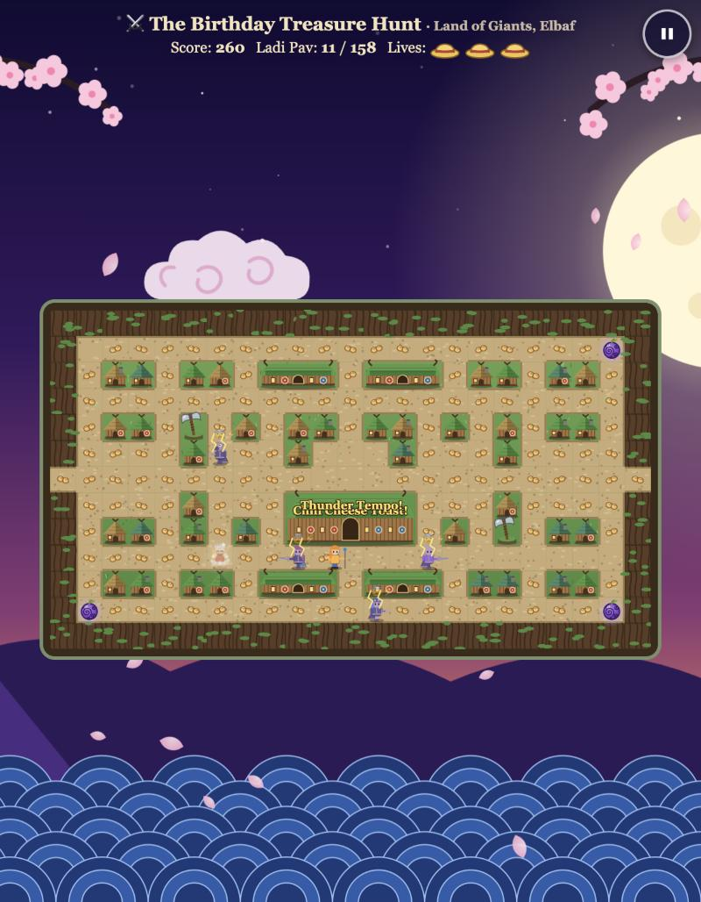
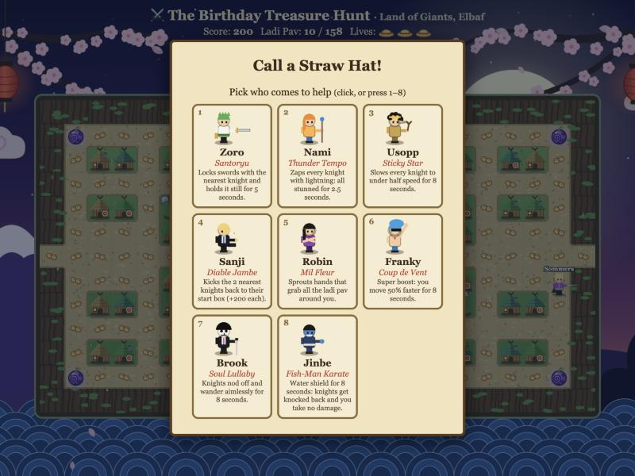
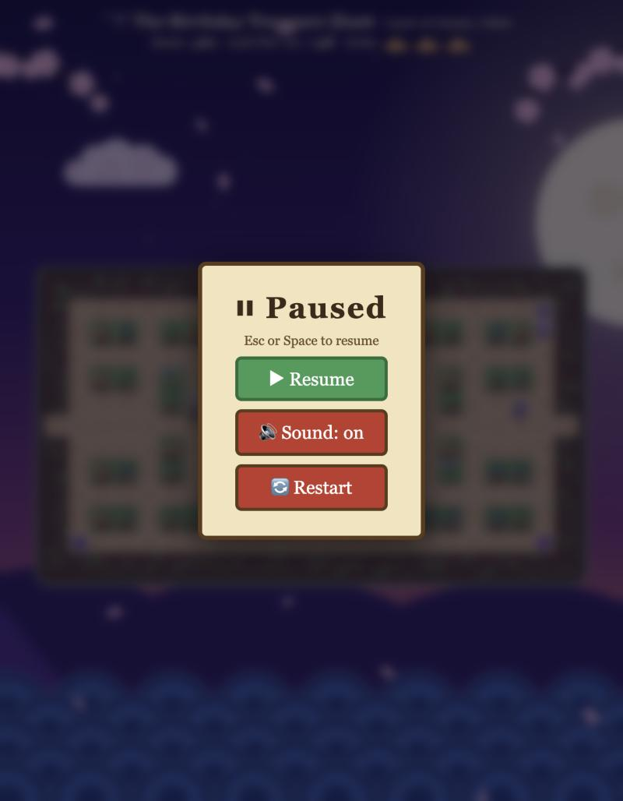
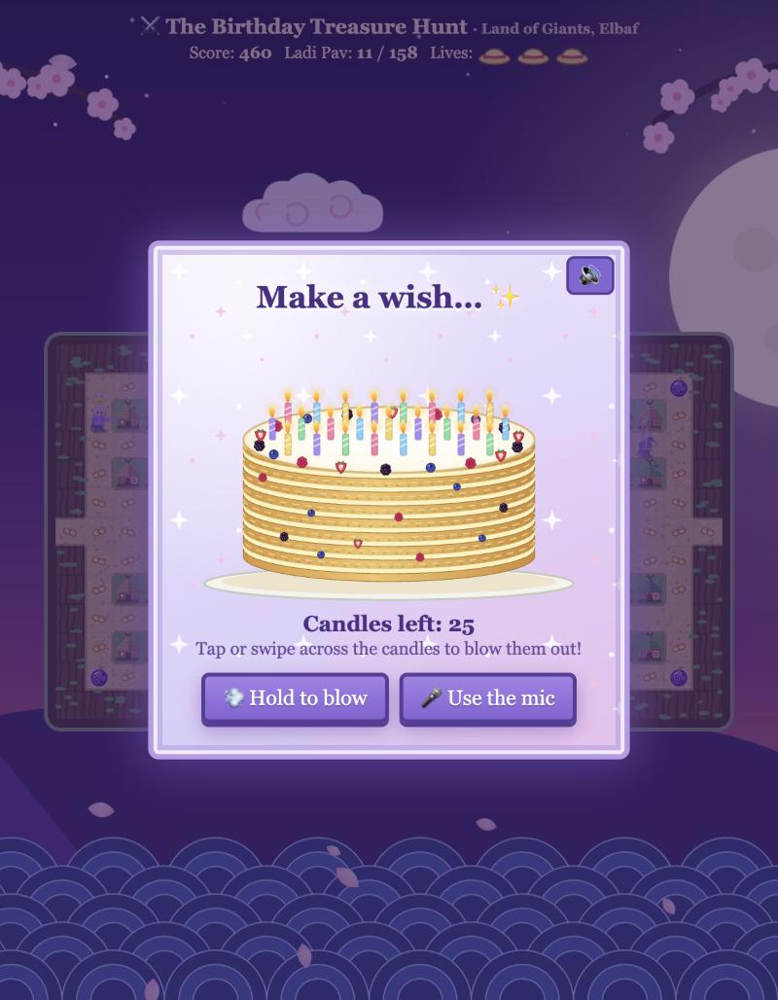

# 🏴‍☠️ The Birthday Treasure Hunt

A Pac-Man-style birthday game set in **Elbaf** (One Piece). You play Luffy, gobble Ladi Pav through a giant-village maze, dodge the four God's Knights, summon Straw Hat crewmates for help, and, if you win, blow out the candles on a Napoleon cake.

It's a single-file browser game: vanilla HTML, CSS and JavaScript with Canvas 2D. There's no build step and no dependencies.

| Gameplay | Summon a crewmate |
|---|---|
|  |  |

| Pause menu | Make a wish |
|---|---|
|  |  |

## Features

- Classic maze chase on a 23×13 grid, with instant turn-buffering and a Wano-night background.
- Four God's Knights (Saint Sommers, Saint Qilingham, Gunko, Shamrock), each with its own chase behaviour.
- **Gomu Gomu no Mi power-up:** Luffy enters Gear 5, is invulnerable, and bounces respawned knights away. The background music stops and the Drums of Liberation play.
- Bonus treats appear every quarter of the Ladi Pav eaten. Eating one lets you summon a Straw Hat crewmate (Zoro, Nami, Usopp, Sanji, Robin, Franky, Brook, Jinbe), each with a unique power. Crewmates you've already used are greyed out for the run.
- Lives are shown as straw hat icons.
- Lose screen: a random funny One Piece quote. Win screen: an inspirational one. Both have a gallery to scroll through every quote.
- Win finale: swipe to blow out 25 candles (or use the mic), cut the cake, and a One Piece-style wanted poster pops out.
- Pause menu: ⏸ button, `Esc` or `Space`. The game also auto-pauses when the tab is hidden.
- Every sound is a swappable mp3 slot, with synthesized fallbacks when a file is missing.

## Play

Browsers block some features (video, audio, module loading) on `file://`, so serve the folder:

```bash
python3 -m http.server 8000
```

Then open <http://localhost:8000>. It works on desktop and on phones (touch/drag).

## Controls

| Action | Input |
|---|---|
| Move | Arrow keys / WASD, or drag on touch |
| Pause / resume | ⏸ button, `Esc` or `Space` |
| Blow candles | Swipe across them, hold the button, or use the mic |

## Project layout

```
index.html      the entire game
images/         portraits, memory photos, wanted poster photo
sounds/         mp3 slots (music, drums, chomp, fruit, lose, ...)
videos/         intro.mp4 (vertical, 9:16)
docs/           README screenshots
```

## Customising

Settings live at the top of the `<script>` in `index.html`: `PLAYER_NAME`, `POSTER_NAME`, `START_LIVES`, `FRIGHT_FRAMES`, `KNIGHT_SPEED`, `BONUS_EVERY`, the `QUOTES` list (`[quote, who, note, group]`), and so on.

**Images** (in `images/`; `png`, `jpg`, `jpeg` and `webp` are all tried):

- `wanted-poster.*`: a complete custom poster. If it's absent, a poster is drawn using `wanted.*` as the photo.
- `memory-1` to `memory-8`: scrapbook photos shown after the candles.
- `<char>-<n>` and `birthday-<char>-<n>`: the portrait shown next to a character's quote, and the matching photo of the birthday person (`luffy-1`, `birthday-luffy-1`, `zoro`, ...).

**Sounds** (in `sounds/`, `.mp3`): `music`, `drums`, `chomp`, `fruit`, `hurt`, `bounce`, `knockout`, `bonus`, `engage`, `power-<name>`, `win`, `lose`, `results`, `cake`, `blow`, `wish`, `cut`, `poster`, `shutter`. Any file you drop in replaces the built-in sound.

**Intro video:** `videos/intro.mp4`. The start button unlocks when it finishes.

## Notes

- Audio starts after the first tap because of browser autoplay rules, hence the "Tap to begin" screen.
- The mic option for the candles needs microphone permission (and HTTPS or localhost).

## Disclaimer

This is an unofficial, non-commercial fan project made as a personal gift. *One Piece* and its characters belong to Eiichiro Oda, Shueisha and Toei Animation. No affiliation or endorsement is implied.
